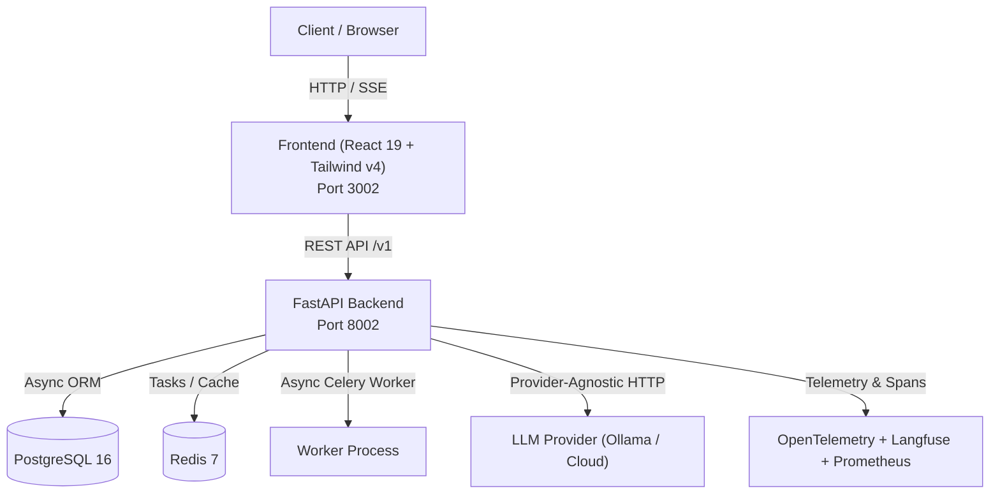

# EvalGate

> **Prevent regressions and measure LLM application quality on every commit**

[](https://github.com/Kyrollo/evalgate/actions)
[](LICENSE)
[](https://www.python.org/downloads/)
[](tests/)

LLM Regression Testing & Quality Gates: statistical significance testing, automated evaluations, and CI quality gates

---

## Architecture Overview



## Quickstart

### Prerequisites
- Docker & Docker Compose OR Python 3.12+ & Node 22+
- Local Ollama running (`ollama serve`) or cloud LLM API key

### Running with Docker Compose
```bash
# 1. Clone repository
git clone https://github.com/Kyrollo/evalgate.git
cd evalgate

# 2. Configure environment
cp .env.example .env

# 3. Start complete stack (Database, Redis, API, Frontend)
docker compose -f deploy/compose.dev.yml up --build
```

Access services:
- **Web Console**: [http://localhost:3002](http://localhost:3002)
- **Backend API**: [http://localhost:8002](http://localhost:8002)
- **API Documentation**: [http://localhost:8002/docs](http://localhost:8002/docs)
- **Metrics**: [http://localhost:8002/metrics](http://localhost:8002/metrics)

---

## Repository Structure

```text
evalgate/
├── backend/            # FastAPI async backend, domain logic, AI pipelines
├── frontend/           # React 19 + Vite + Tailwind CSS v4 frontend
├── evaluation/         # Reproducible evaluation harness and benchmarks
├── docs/               # Complete MkDocs Material technical documentation
├── deploy/             # Docker Compose configurations (dev, prod, gpu)
├── scripts/            # CI validation, smoke tests, utility scripts
└── .github/workflows/  # CI/CD pipelines
```

## License
MIT License. See [LICENSE](LICENSE) for details.
