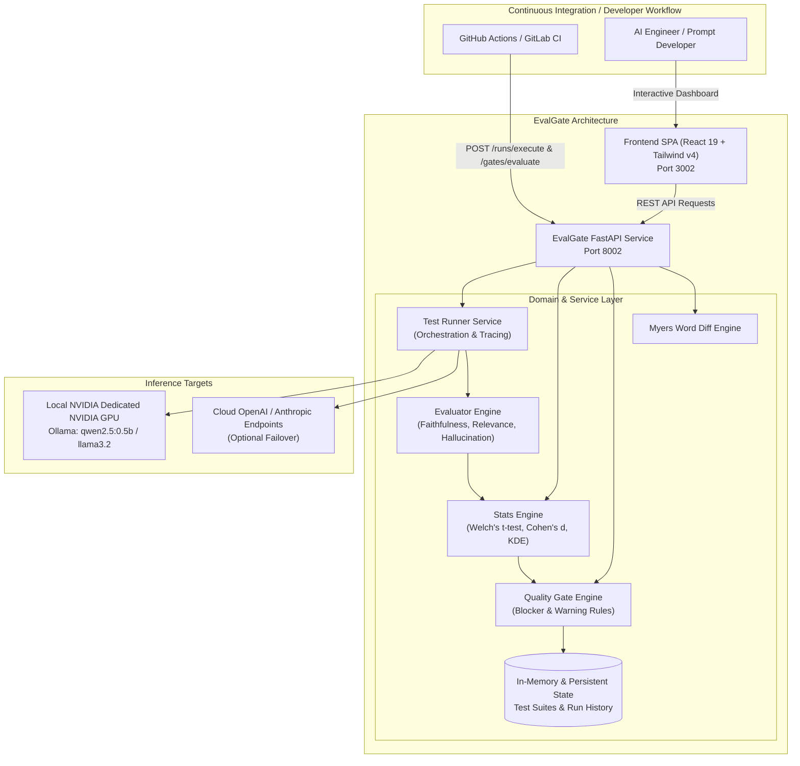
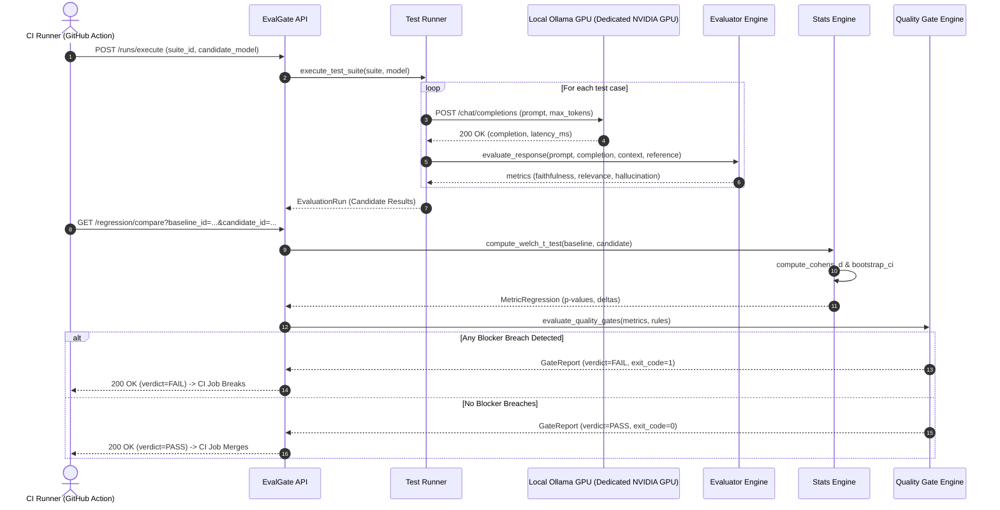
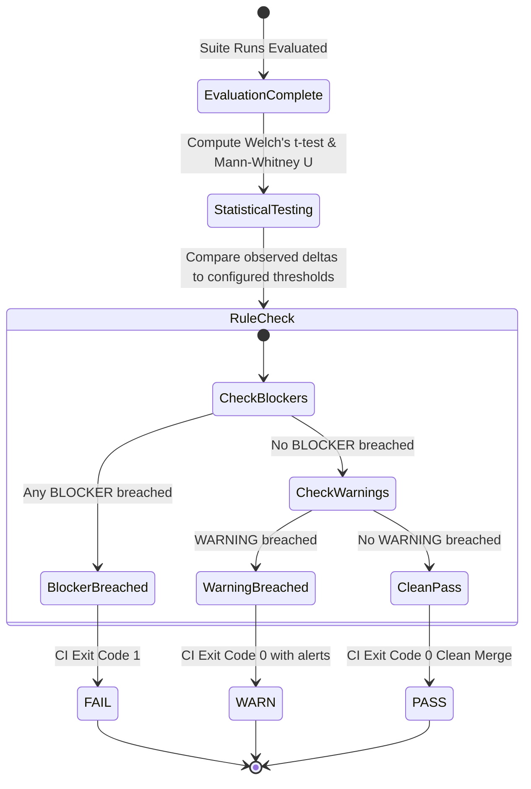

# System Architecture & Technical Design

## 1. Overview
**EvalGate** provides automated LLM regression testing and statistical quality gate enforcement for enterprise CI/CD workflows. It executes prompt suites across model versions, measures qualitative and factual metrics (faithfulness, answer relevance, hallucination rate, semantic similarity), runs two-sample Welch's t-tests and non-parametric Mann-Whitney U hypothesis tests, and issues deterministic CI pass/fail status codes.

---

## 2. C4 Container Diagram

---

## 3. CI/CD Quality Gate Pipeline Sequence

---

## 4. Quality Gate State Machine

