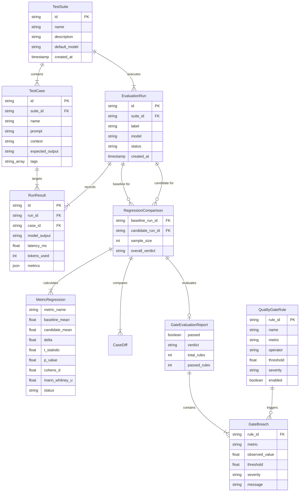

# Data Model & Entity Specifications

## 1. Entity Relationship Diagram (ERD)

---

## 2. Statistical Metric Definitions

| Metric Field | Type | Description |
| :--- | :--- | :--- |
| `correctness` | float [0, 1] | Hybrid character token sequence alignment and Jaccard token overlap against reference ground truth. |
| `faithfulness` | float [0, 1] | Propositional grounding verification measuring factual agreement with context document. |
| `answer_relevance`| float [0, 1] | Semantic keyword intent overlap and length sufficiency answering prompt query. |
| `hallucination` | float [0, 1] | Inverse factual grounding rate ($1.0 - \text{faithfulness}$) detecting ungrounded claims. |
| `p_value` | float [0, 1] | Two-tailed Welch's $t$-test probability value under null hypothesis of identical distributions. |
| `cohens_d` | float | Standardized mean difference effect size measuring practical significance ($d \ge 0.8$ is large). |
| `mann_whitney_u` | float | Non-parametric rank-sum test statistic invariant to distribution non-normality. |
| `ci_95` | tuple [low, high]| 95% Bootstrap empirical percentile confidence interval for $\mu_{\text{candidate}} - \mu_{\text{baseline}}$. |
