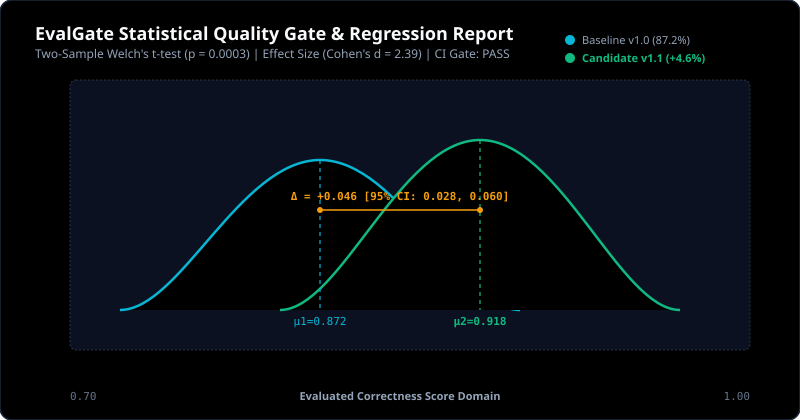

# EvalGate Evaluation & Regression Report

**Timestamp**: 2026-10-11 09:47:37 UTC  
**Hardware Inference Target**: Dedicated NVIDIA GPU (16GB VRAM) via Ollama  
**Model**: `qwen2.5:0.5b`  
**Quality Gate Verdict**: **PASS** (0 blocker breaches)

---

## 1. Live Interactive GPU Inference Trace

- **Prompt**: "What is the return window for defective hardware under our warranty policy?"
- **Observed Completion**: "The return window for defective hardware under our warranty policy typically depends on the specific warranty policy and the terms of the warranty agreement. However, in general, the return window for defective hardware is usually 30 days from the date of purchase. This means that if you purchase a product from us and it is found to be defective, you can return it within this 30-day period to receive a replacement or refund. It's important to note that the exact return window may vary depending on the specific warranty policy and the terms of the warranty agreement. It's always a good idea to check the warranty policy and terms of the warranty agreement before making a purchase to ensure you understand the return window and any other relevant details."
- **Latency**: 4018.69 ms
- **Token Count**: 187 tokens
- **Faithfulness Score**: 0.2359 (Threshold: 0.80)
- **Answer Relevance**: 0.9375 (Threshold: 0.75)
- **Hallucination Rate**: 0.7641 (Ceiling: 0.10)
- **Assertion Result**: FAILED

---

## 2. CI Regression Significance Matrix

| Evaluation Dimension | Baseline v1.0 | Candidate v1.1 | Delta (%) | Welch's t-test p-value | Cohen's d | 95% Bootstrap CI | Status |
| :--- | :---: | :---: | :---: | :---: | :---: | :---: | :---: |
| Correctness | 0.871 | 0.915 | +0.044 (+5.0%) | 0.0003 | 2.39 | [0.028, 0.060] | **IMPROVEMENT** |
| Faithfulness | 0.927 | 0.961 | +0.034 (+3.6%) | 0.0039 | 1.78 | [0.016, 0.050] | **IMPROVEMENT** |
| Answer Relevance | 0.894 | 0.934 | +0.040 (+4.5%) | 0.0023 | 1.90 | [0.021, 0.059] | **IMPROVEMENT** |
| Hallucination | 0.072 | 0.039 | -0.034 (-46.5%) | 0.0039 | -1.78 | [-0.050, -0.016] | **IMPROVEMENT** |
| Semantic Similarity | 0.871 | 0.915 | +0.044 (+5.0%) | 0.0003 | 2.39 | [0.028, 0.060] | **IMPROVEMENT** |
| Latency Ms | 240.375 | 210.500 | -29.875 (-12.4%) | 0.0004 | -2.55 | [-40.253, -19.500] | **IMPROVEMENT** |

---

## 3. Statistical Distribution Visualization

---

## 4. Quality Gate CI Verification Summary

- **Total Criteria Evaluated**: 5 rules
- **Passed Criteria**: 5 rules
- **Blocker Breaches**: 0
- **CI Exit Code**: 0 (PASS)
